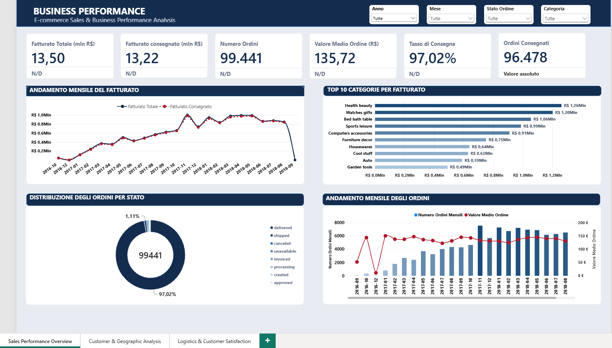
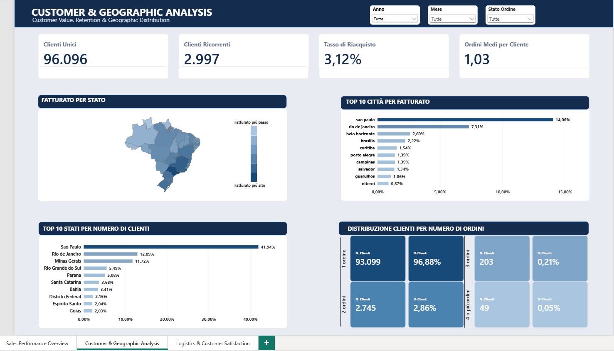
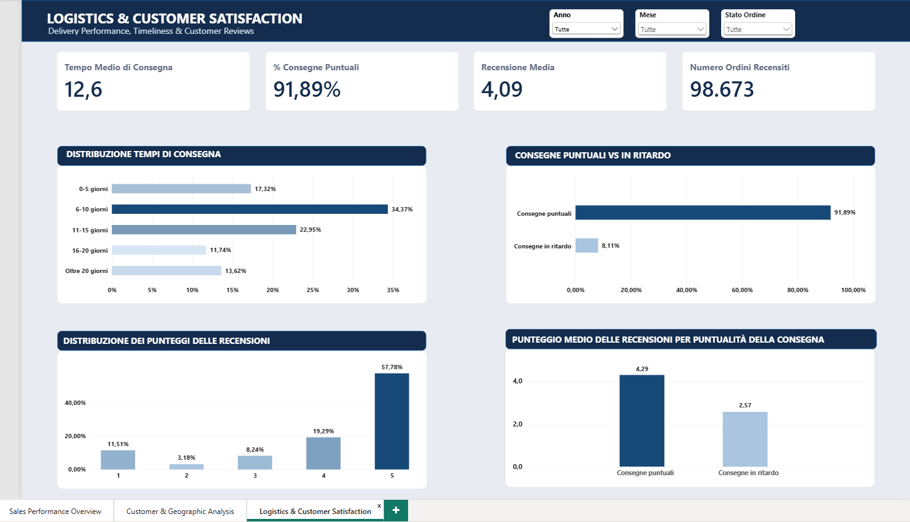

# Business Performance Analytics

## Project Overview

Business Performance Analytics is an end-to-end data analytics project based on the Brazilian e-commerce public dataset Olist.

The project aims to analyze business performance, customer behavior, geographic distribution, logistics efficiency and customer satisfaction through SQL analysis and interactive Power BI dashboards.

## Business Objectives

The main objectives are:

- Analyze revenue and sales performance.
- Monitor order volumes and order statuses.
- Understand customer behavior and purchasing patterns.
- Identify geographic areas with the highest customer concentration and revenue.
- Evaluate delivery performance and logistics efficiency.
- Analyze customer reviews and satisfaction.

## Dataset

The project uses the public **Brazilian E-Commerce Public Dataset by Olist**, containing information about customers, orders, products, payments, reviews and deliveries.

## Tools & Technologies

- **Google BigQuery** – Cloud data warehouse and SQL analysis.
- **SQL** – Data quality checks, relational analysis and analytical views.
- **Microsoft Power BI** – Data modeling, KPI development and interactive dashboards.
- **GitHub** – Project version control and documentation.

## Data Architecture & Workflow

The project follows these main steps:

1. Data loading into Google BigQuery.
2. Data quality checks and validation.
3. Analysis of relationships between datasets.
4. SQL queries for business performance analysis.
5. Creation of analytical views for Power BI.
6. Development of interactive dashboards.

## SQL Analysis

The `sql/` folder contains the SQL scripts developed during the project:

| File | Description |
|---|---|
| `01_data_quality.sql` | Data quality checks and validation |
| `02_relazioni_tabelle.sql` | Analysis and verification of table relationships |
| `03_analisi_performance_commerciale.sql` | Commercial performance analysis |
| `04_data_modeling_powerbi.sql` | Creation of analytical views for Power BI |

## Power BI Dashboards

The project includes three interactive dashboards.

### 1. Business Performance

**KPIs**

- Total Revenue (mln R$)
- Delivered Revenue (mln R$)
- Number of Orders
- Average Order Value (R$)
- Delivery Rate
- Delivered Orders

**Visualizations**

- Monthly Revenue Trend
- Top 10 Categories by Revenue
- Order Status Distribution
- Monthly Orders Trend

### 2. Customer & Geographic Analysis

**KPIs**

- Unique Customers
- Returning Customers
- Repurchase Rate
- Average Orders per Customer

**Visualizations**

- Brazil Geographic Revenue Map
- Top 10 States by Number of Customers
- Top 10 Cities by Revenue
- Customer Distribution by Number of Orders

**Objective:** Understand geographic market distribution and customer purchasing behavior.

### 3. Logistics & Customer Satisfaction

**KPIs**

- Average Delivery Time
- On-Time Delivery Rate
- Late Delivery Rate
- Average Review Score
- Number of Reviewed Orders

**Visualizations**

- Delivery Time Distribution
- On-Time vs. Late Deliveries
- Review Score Distribution
- Average Review Score by Delivery Punctuality

**Objective:** Evaluate logistics efficiency and customer satisfaction.

## Dashboard Preview

### 1. Business Performance



### 2. Customer & Geographic Analysis



### 3. Logistics & Customer Satisfaction



## Repository Structure

```text
Business-Performance-Analytics/
│
├── dashboard/
│   └── Business_Performance_Analytics.pbix
│
├── data/
│   └── raw/
│       └── CSV datasets
│
├── screenshots/
│   ├── 01_business_performance.png
│   ├── 02_customer_geographic_analysis.png
│   └── 03_logistics_customer_satisfaction.png
│
├── sql/
│   ├── 01_data_quality.sql
│   ├── 02_relazioni_tabelle.sql
│   ├── 03_analisi_performance_commerciale.sql
│   └── 04_data_modeling_powerbi.sql
│
├── .gitignore
└── README.md
```

## Project Status

Completed portfolio project.

## Notes

- The project uses a publicly available dataset.
- Revenue values are expressed in Brazilian Reais (R$).
- The dashboards are designed for interactive business analysis.